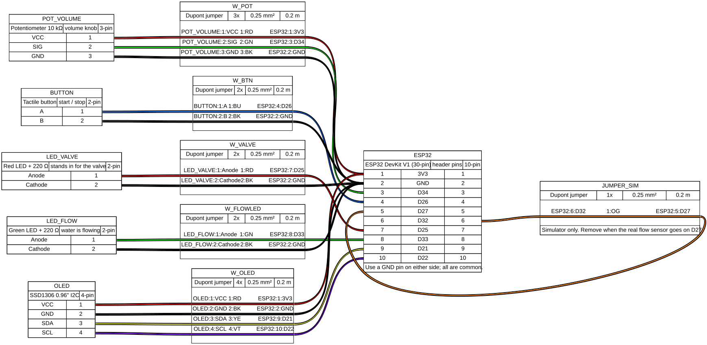

# Water dispenser

ESP32 controller that pours a set amount of water.

1. Turn the knob (potentiometer) to choose a volume, 0–5 L.
2. Press the button: the valve opens.
3. The flow sensor's pulses are counted; when the target is reached the valve closes.
4. The next button press starts a new cycle.

Status: **home bench stub.** No valve, relay or real sensor yet — the ESP32 simulates the
flow sensor. The valve, driver and sensor are chosen later with the person on site.



## Behaviour

| Event | Result | Screen |
|-------|--------|--------|
| Idle | Shows the volume selected by the knob | `Готово`, big number, `Кнопка = старт` |
| Button, idle | Valve opens, counting starts | `Наливаю`, poured / target, progress bar |
| Target reached | Valve closes | `Готово!` |
| No pulses for 5 s while open | Valve closes (dry run / no water) | `Немає води!` |
| Button while pouring | Valve closes (emergency stop) | `Стоп кнопкою` |
| Volume too small (< 10 pulses) | Ignored | `Замало` |

LEDs: **red** = valve commanded open, **green** = pulses actually arriving.
Red without green means the valve is open but no water flows.

## Hardware for the stub

ESP32 DevKit V1 (30-pin), 10 kΩ pot, tactile button, red + green LEDs with 220 Ω,
SSD1306 0.96" I2C OLED, one jumper wire D32 → D27. Full pin table: [PINOUT.md](PINOUT.md).

## Build and flash

Uses [PlatformIO](https://platformio.org/) (VS Code extension or `pip install platformio`).

```sh
cd projects/water-dispenser
pio run -e sim -t upload      # stub with built-in flow simulator
pio device monitor            # 115200 baud
```

`env:real` builds without the simulator, for the real flow sensor on D27.
Arduino IDE also works: copy `src/main.cpp` into a sketch, install **U8g2**, and set
`#define SIMULATE_FLOW 1` at the top.

## Run it without hardware (Wokwi)

`diagram.json` + `wokwi.toml` describe the same circuit for the [Wokwi](https://wokwi.com) simulator.

- **VS Code:** install the Wokwi extension, `pio run -e sim`, then *Wokwi: Start Simulator*.
- **Automated test:** `wokwi-cli --scenario test/dispense.test.yaml --timeout 30000 .`
  sets the knob to 1 L, presses the button and waits for `STOP (Готово!)`.
  Needs a free `WOKWI_CLI_TOKEN`.

## Tests on the bench

- Limit: knob at 1 L → stops after ~10 s (simulator runs at 6 L/min).
- No water: pull the D32→D27 jumper while pouring → green LED off, `Немає води!` after 5 s.
- Emergency stop: press the button while pouring.
- Variable flow: set `HAS_RATE_POT=1`, add a second pot on D35; the poured volume must stay the same at any rate.

## Calibration (with the real sensor)

The YF-S201 nominal value is ~450 pulses/L but every unit differs.
Pour into a measuring jug, read the pulse count from the serial `STOP` line,
divide by litres, and update `PULSES_PER_LITER`. Water keeps flowing briefly
after the valve closes; if it overshoots, stop a few pulses early.

## Roadmap

- [x] Bench stub with flow simulator, OLED, status LEDs
- [x] Wokwi circuit + scenario test, WireViz wiring diagram
- [ ] Verify on hardware, tune debounce and display
- [ ] On site: choose valve (pressure vs. gravity tank), driver, power
- [ ] Real sensor: level shifting, calibration, overshoot compensation
- [ ] Optional: rotary encoder instead of pot, Wi-Fi log / settings page

## Files

| Path | What |
|------|------|
| `src/main.cpp` | Firmware |
| `platformio.ini` | Build config, `sim` and `real` environments |
| `PINOUT.md` | Pin table — source of truth for wiring |
| `diagram.json`, `wokwi.toml` | Wokwi simulator circuit |
| `test/dispense.test.yaml` | Wokwi CLI scenario test |
| `docs/wiring.yml` | WireViz source; `wiring.svg/png` and BOM are generated from it |
