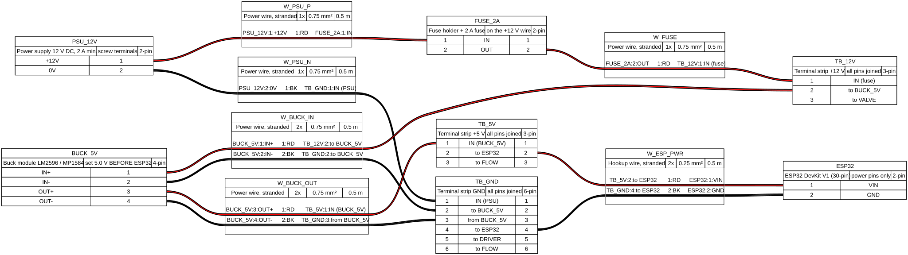
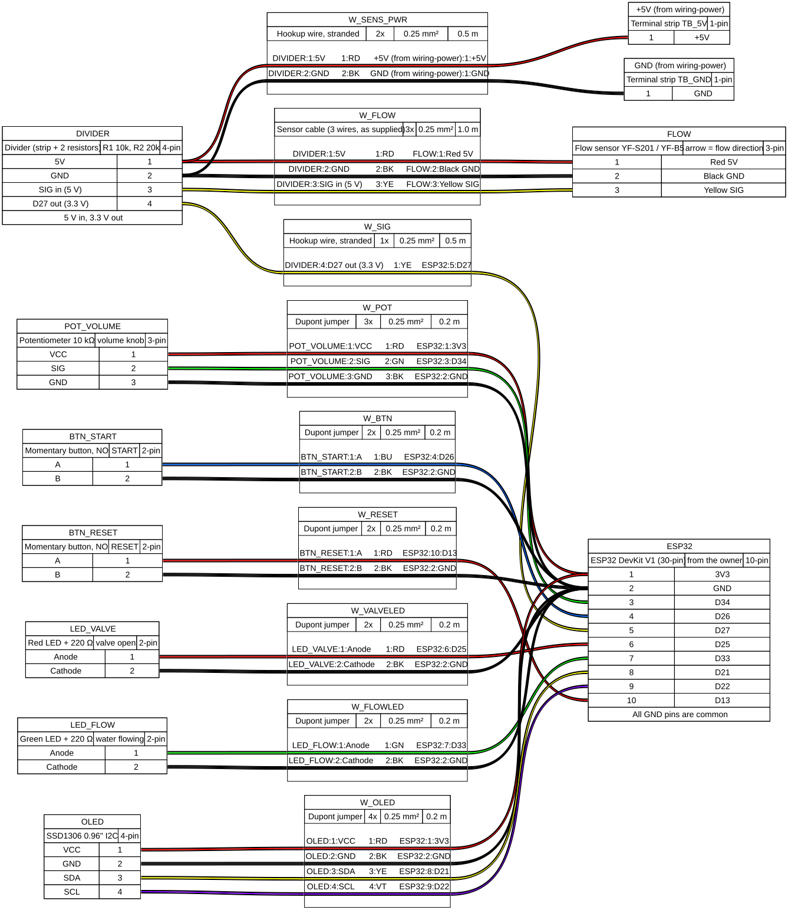
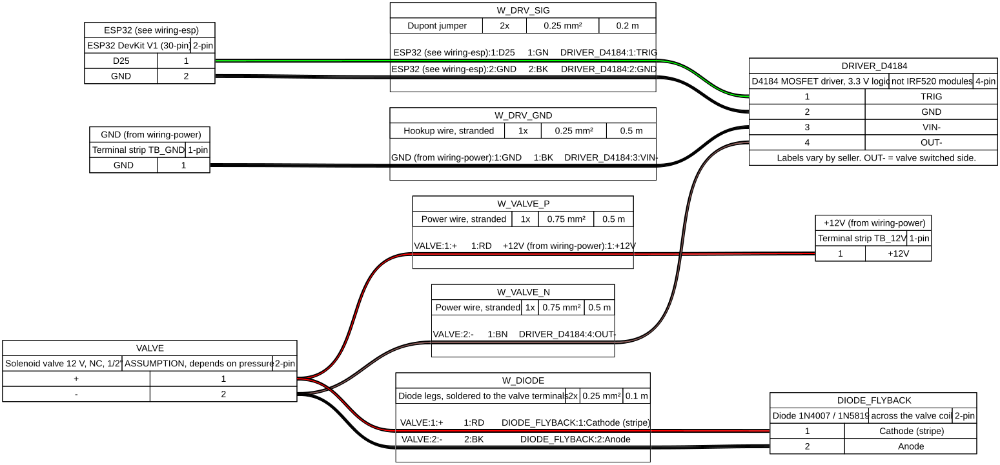

# Дозатор води — інструкція для електрика

Ця інструкція — для реального пристрою (не стендового). Плату ESP32 DevKit V1 дає власник.
Решту деталей купуєте самі. Паяти плати не треба: клемники, Dupont-дроти, паяні дроти.

Спочатку огляньте загальну схему. Потім у кожному кроці нижче є своя схема підключення (дроти, кольори, клемники).

Загальна схема: [schematic-real.svg](schematic-real.svg)

Схеми підключення (з кольорами дротів):

- Живлення: [wiring-power.svg](wiring-power.svg) ([PNG](wiring-power.png), [список деталей](wiring-power.bom.tsv)). Кроки 1 і 2.
- ESP32, датчик, кнопки, екран: [wiring-esp.svg](wiring-esp.svg) ([PNG](wiring-esp.png), [список деталей](wiring-esp.bom.tsv)). Кроки 3 і 4.
- Клапан і драйвер: [wiring-valve.svg](wiring-valve.svg) ([PNG](wiring-valve.png), [список деталей](wiring-valve.bom.tsv)). Крок 5.

На схемах підключення блоки з написом "(from wiring-power)" або "(see wiring-esp)" — це лише вказівка на іншу схему. Самі деталі там не дублюються.

## Що ще не вирішено (припущення)

1. **Клапан.** Тип залежить від води в магістралі.
   - Є тиск у трубі: підійде клапан з пілотним керуванням (pilot-operated).
   - Бак без тиску або самопливом: потрібен клапан прямої дії (direct-acting, "zero pressure").
   - Це ПРИПУЩЕННЯ. Уточніть з власником до покупки.
2. **Струм клапана.** Перевірте на шильдику. Він має бути менший за номінал модуля D4184 і за блок живлення (2 А з запасом).
3. **Корпус і захист від води.** Не вирішено. Електроніку розмістіть окремо від води, у закритому корпусі, нижче рівня труб не ставте. Усі з'єднання на 12 В — тільки в клемниках або з ізоляцією.

## Позначки на схемі

На схемах підписи англійською. Ось що вони означають.

| Позначка на схемі | Що це |
|---|---|
| `PSU_12V` | блок живлення 12 В постійного струму, від 2 А |
| `FUSE_2A` | запобіжник 2 А в тримачі, у розрив дроту +12 В |
| `TB_12V` | клемник +12 В (на 5 А і більше). Усі виводи клемника з'єднані між собою |
| `TB_5V` | клемник `TB_5V`. Усі виводи з'єднані між собою |
| `TB_GND` | клемник `TB_GND` (мінус). Усі виводи з'єднані між собою |
| `BUCK_5V` | знижувальний модуль 12 → 5 В (LM2596 або MP1584) |
| `ESP32` | плата ESP32 DevKit V1 (від власника) |
| `DRIVER_D4184` | драйвер клапана — модуль на MOSFET D4184 |
| `VALVE` | електромагнітний клапан 12 В, нормально закритий, 1/2" |
| `DIODE_FLYBACK` | захисний діод 1N4007 (або 1N5819) на котушці клапана |
| `FLOW` | датчик потоку води YF-S201 (або YF-B5) |
| `DIVIDER` | дільник напруги для сигналу датчика: резистор 10 кОм і 20 кОм |
| `POT_VOLUME` | потенціометр 10 кОм (ручка вибору об'єму) |
| `BTN_START` | кнопка START (старт, пауза, продовження) |
| `BTN_RESET` | кнопка RESET (скинути) |
| `LED_VALVE` | червоний індикатор: клапан відкритий (з резистором 220 Ом) |
| `LED_FLOW` | зелений індикатор: вода тече (з резистором 220 Ом) |
| `OLED` | екран SSD1306 0.96" I2C |
| `+12V (from wiring-power)`, `+5V (from wiring-power)`, `GND (from wiring-power)` | вказівка: цей дріт іде до клемника `TB_12V`, `TB_5V` або `TB_GND` зі схеми живлення |
| `ESP32 (see wiring-esp)` | вказівка: цей дріт іде до плати `ESP32` (див. схему ESP32) |
| `W_...` | дроти (cables) на схемі: колір і переріз вказані на схемі |

## Список покупок

| Деталь | Параметри | К-сть | Примітки |
|---|---|---|---|
| Блок живлення (`PSU_12V`) | 12 В DC, від 2 А | 1 | |
| Тримач запобіжника + запобіжник (`FUSE_2A`) | 2 А | 1 | на дріт +12 В |
| Знижувальний модуль (`BUCK_5V`) | LM2596 або MP1584, 12 → 5 В | 1 | з підстроювальним гвинтом |
| Клапан (`VALVE`) | 12 В DC, нормально закритий, 1/2" | 1 | ПРИПУЩЕННЯ: тип залежить від тиску (див. вище) |
| Драйвер (`DRIVER_D4184`) | модуль D4184, логіка 3.3 В | 1 | НЕ брати модулі IRF520 |
| Діод (`DIODE_FLYBACK`) | 1N4007 або 1N5819 | 1 | не потрібен, якщо вже є на модулі |
| Датчик потоку (`FLOW`) | YF-S201 або YF-B5 (латунь), 1/2" | 1 | |
| Резистор | 10 кОм, 0.25 Вт | 1 | у `DIVIDER` |
| Резистор | 20 кОм, 0.25 Вт | 1 | у `DIVIDER` |
| Екран (`OLED`) | SSD1306 0.96" I2C, 4 піни | 1 | |
| Потенціометр (`POT_VOLUME`) | 10 кОм, лінійний (B10K) | 1 | |
| Кнопка (`BTN_START`, `BTN_RESET`) | без фіксації, нормально розімкнена | 2 | можна панельні |
| Світлодіоди (`LED_VALVE`, `LED_FLOW`) | червоний і зелений, 3 мм або 5 мм | 2 | необов'язково, але бажано; можна панельні |
| Резистор для світлодіода | 220 Ом | 2 | по одному на світлодіод |
| Клемники (`TB_12V`, `TB_5V`, `TB_GND`) | на 5 А і більше | три групи, за потребою | окремий клемник під кожну лінію: +12 В, +5 В, GND |
| Дроти | 0.75 мм² для 12 В; 0.25 мм² для сигналів; Dupont | за потребою | кольори: червоний +, чорний GND |
| Корпус | захищений від води | 1 | ПРИПУЩЕННЯ: не вирішено |

## Таблиця виводів

Усі GPIO збігаються з `src/main.cpp` і `PINOUT.md`.

| GPIO | Напис на платі | З'єднується з |
|---|---|---|
| 34 | D34 | потенціометр `POT_VOLUME`, середній вивід (SIG) |
| 26 | D26 | кнопка `BTN_START`, другий вивід кнопки на GND |
| 13 | D13 | кнопка `BTN_RESET`, другий вивід кнопки на GND |
| 27 | D27 | вихід дільника `DIVIDER` (3.3 В), НЕ напряму від датчика |
| 25 | D25 | вхід TRIG модуля `DRIVER_D4184` і червоний LED (через 220 Ом на GND) |
| 33 | D33 | зелений LED (через 220 Ом на GND) |
| 21 | D21 | екран `OLED`, SDA |
| 22 | D22 | екран `OLED`, SCL |
| — | 3V3 | ВИХІД плати: живить `OLED` VCC і потенціометр (крайній вивід). Зовнішні 3.3 В НЕ подавати |
| — | VIN | +5 В з `BUCK_5V` |
| — | GND | усі GND разом |

Перемичку D32 → D27 НЕ ставити. Вона тільки для стенда.
Прошивка для цього пристрою: `pio run -e real`.

## Порядок підключення

Правило: поки збираєте, блок живлення вимкнений з розетки.

### Крок 1. Живлення і модуль 5 В (ESP32 ще не підключати)

Схема: [wiring-power.svg](wiring-power.svg)

1. `PSU_12V` плюс -> `FUSE_2A` -> клемник `TB_12V`. Мінус -> клемник `TB_GND`.
2. `BUCK_5V` вхід: IN+ на +12 В, IN- на GND. Вихід поки нікуди не підключайте.
3. Перевірте полярність мультиметром ще раз. Червоний дріт тільки на +.
4. Увімкніть блок живлення в розетку.
5. Мультиметр на OUT+ та OUT- модуля `BUCK_5V`. Крутіть підстроювальний гвинт, поки не буде **5.0 В**.
6. Вимкніть блок живлення з розетки. Тільки тепер підключайте ESP32.

### Крок 2. Живлення ESP32

1. OUT+ модуля -> клемник `TB_5V`. OUT- -> клемник `TB_GND`.
2. З клемника `TB_5V` на VIN плати `ESP32`. З клемника `TB_GND` на GND плати.
3. Нічого більше поки не додавайте.

### Крок 3. Екран, ручка, кнопки, світлодіоди (Dupont)

Схема: [wiring-esp.svg](wiring-esp.svg) (на ній же датчик потоку з кроку 4)

1. `OLED`: VCC -> 3V3, GND -> GND, SDA -> D21, SCL -> D22.
2. `POT_VOLUME`: один край -> 3V3, другий край -> GND, середній -> D34.
3. `BTN_START`: один вивід на D26, другий на GND. Резистор не потрібен.
4. `BTN_RESET`: один вивід на D13, другий на GND. Резистор не потрібен.
5. `LED_VALVE` (червоний): анод (довга ніжка) через 220 Ом на D25, катод на GND.
6. `LED_FLOW` (зелений): анод через 220 Ом на D33, катод на GND.

### Крок 4. Датчик потоку

1. Знайдіть стрілку на корпусі `FLOW`. Вона показує напрямок води. Встановіть датчик за стрілкою.
2. Червоний дріт датчика -> клемник `TB_5V`. Чорний -> клемник `TB_GND`.
3. Жовтий (сигнал) -> резистор 10 кОм -> точка D27.
4. Від точки D27 -> резистор 20 кОм -> GND. Це і є `DIVIDER`.
5. Чому так: датчик дає 5 В, а ESP32 витримує тільки 3.3 В. Без дільника плата може згоріти.

### Крок 5. Клапан і драйвер

Схема: [wiring-valve.svg](wiring-valve.svg)

1. `DRIVER_D4184`: сигнал (TRIG) -> D25, GND модуля -> GND плати `ESP32`.
2. Підписи на модулях різні. Дивіться фото від продавця. Суть така: плюс 12 В -> клапан -> вивід OUT- модуля.
3. Клемник `TB_12V` -> один дріт клапана `VALVE`. Другий дріт клапана -> OUT- модуля.
4. Мінус живлення модуля (VIN-) -> клемник `TB_GND`.
5. Діод `DIODE_FLYBACK` паралельно котушці клапана. **Катод (смужка) до +12 В**, анод до дроту, що йде на OUT-.
6. Якщо діод поставити навпаки, буде коротке замикання, а запобіжник перегорить.
7. Без діода MOSFET може згоріти від викиду напруги котушки. Діод потрібен, якщо його немає на модулі.

### Крок 6. Перевірка перед вмиканням

- Усі GND з'єднані разом: мінус блоку, GND модуля 5 В, GND плати, GND драйвера, чорний дріт датчика.
- Плюс 12 В не торкається жодного піна ESP32.
- Діод: смужка до +12 В.
- Датчик: жовтий дріт іде тільки через дільник.
- Перемички D32 -> D27 немає.

## Увімкнення і перевірка

1. Спочатку **без підключеного клапана**. Увімкніть блок живлення.
2. На екрані має з'явитися `Готово` і число (об'єм). Якщо екран чорний — вимкніть і перевірте крок 2 і 3.
3. Крутіть ручку: число змінюється від 0 до 5 л.
4. Натисніть START: червоний світлодіод загорається. На модулі D4184 теж має засвітитися індикатор.
5. Натисніть RESET: червоний гасне.
6. Вимкніть живлення. Підключіть клапан. Увімкніть знову.
7. Натисніть START: клапан має клацнути. Натисніть RESET: клацнути ще раз.
8. Пропустіть воду. Зелений світлодіод горить, поки йдуть імпульси від датчика.

Якщо щось гріється, димить або пахне — вимкніть блок живлення з розетки.

## Як перевірити роботу

| Дія | Що має бути |
|---|---|
| Крутити ручку | на екрані число 0–5 л |
| START | `Наливаю`, клапан відкритий, горить червоний LED, на екрані набране / ціль |
| START під час наливу | `Пауза`, клапан закритий |
| START ще раз | `Наливаю`, налив продовжується |
| Досягнуто потрібного об'єму | клапан закривається, `Готово!` |
| RESET будь-коли | `Скинуто`, клапан закритий, лічильник скинуто |
| Немає води (5 с без імпульсів) | клапан закривається, `Немає води!`; START продовжує |
| Дуже малий об'єм (менше 10 імпульсів) | `Замало` |

Червоний LED без зеленого означає: клапан відкритий, але вода не тече.

## Калібрування

Датчик YF-S201 дає приблизно 450 імпульсів на літр (`PULSES_PER_LITER = 450` у `src/main.cpp`).
Кожен датчик трохи інший. Налийте воду в мірну ємність, подивіться кількість імпульсів у рядку `STOP`
у serial-моніторі (`pio device monitor`, 115200), поділіть на літри. Нове число запишіть
у `PULSES_PER_LITER` і перепрошийте (`pio run -e real -t upload`).
