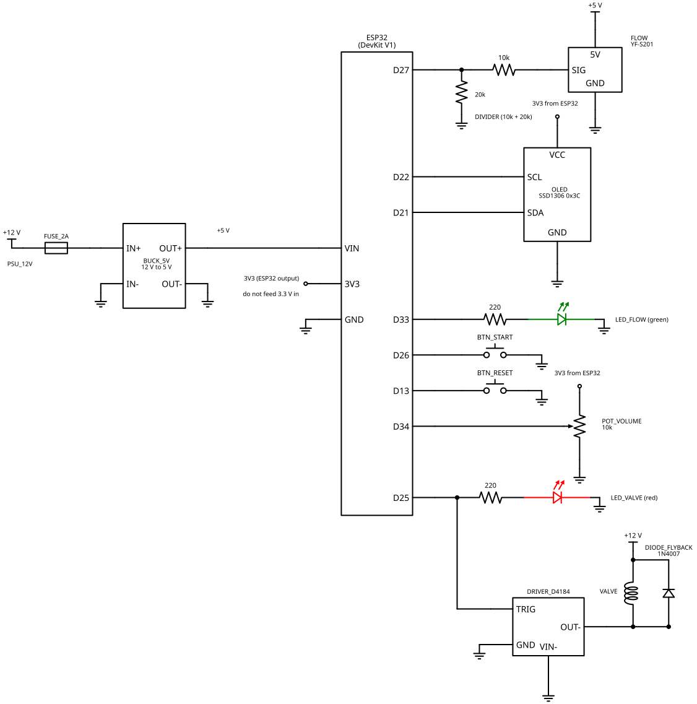

# Дозатор води — опис підключення

Контролер на ESP32 DevKit V1 (30 пінів) відкриває електромагнітний клапан 12 В і закриває його,
коли датчик потоку відрахує заданий об'єм. Об'єм задається потенціометром (0–5 л),
керування — кнопками START і RESET, стан — на екрані OLED.

## Схеми

Загальна схема:

Схеми з'єднань (дроти, кольори, клемники):

- Живлення: [wiring-power.svg](wiring-power.svg)
- ESP32 і периферія: [wiring-esp.svg](wiring-esp.svg)
- Клапан і драйвер: [wiring-valve.svg](wiring-valve.svg)

Блоки з написом "(from wiring-power)" або "(see wiring-esp)" посилаються на іншу схему.

## Відкриті питання

| Питання | Від чого залежить |
|---|---|
| Тип клапана | Магістраль під тиском: пілотний (pilot-operated). Бак без тиску: прямої дії (direct-acting, zero pressure). |
| Струм клапана | Має бути в межах модуля D4184 і блока живлення 2 А. |
| Корпус | Захист від води, розміщення електроніки окремо від гідравліки. |

## Позначки на схемах

| Позначка | Що це |
|---|---|
| `PSU_12V` | блок живлення 12 В DC, від 2 А |
| `FUSE_2A` | запобіжник 2 А на лінії +12 В |
| `TB_12V`, `TB_5V`, `TB_GND` | клемники ліній +12 В, +5 В, GND |
| `BUCK_5V` | знижувальний модуль 12 → 5 В (LM2596 або MP1584) |
| `ESP32` | плата ESP32 DevKit V1 (30 пінів) |
| `DRIVER_D4184` | MOSFET-модуль D4184, керування клапаном |
| `VALVE` | електромагнітний клапан 12 В DC, нормально закритий, 1/2" |
| `DIODE_FLYBACK` | діод 1N4007 (або 1N5819) паралельно котушці клапана |
| `FLOW` | датчик потоку YF-S201 (або YF-B5) |
| `DIVIDER` | дільник сигналу датчика 10 кОм / 20 кОм |
| `POT_VOLUME` | потенціометр 10 кОм, лінійний — вибір об'єму |
| `BTN_START` | кнопка START: старт, пауза, продовження |
| `BTN_RESET` | кнопка RESET: скидання |
| `LED_VALVE` | червоний індикатор: клапан відкритий |
| `LED_FLOW` | зелений індикатор: є імпульси датчика |
| `OLED` | екран SSD1306 0.96" I2C, адреса 0x3C |
| `W_...` | дроти; переріз і колір вказані на схемі |

## Матеріали

| Позначка | Параметри | К-сть | Примітки |
|---|---|---|---|
| `PSU_12V` | 12 В DC, від 2 А | 1 | |
| `FUSE_2A` | 2 А, з тримачем | 1 | |
| `BUCK_5V` | LM2596 або MP1584, регульований | 1 | |
| `VALVE` | 12 В DC, NC, 1/2" | 1 | тип — див. відкриті питання |
| `DRIVER_D4184` | D4184, логіка 3.3 В | 1 | модулі IRF520 не підходять (не відкриваються від 3.3 В) |
| `DIODE_FLYBACK` | 1N4007 або 1N5819 | 1 | якщо на модулі немає свого |
| `FLOW` | YF-S201 або YF-B5, 1/2" | 1 | |
| `DIVIDER` | 10 кОм + 20 кОм, 0.25 Вт | 1+1 | |
| `OLED` | SSD1306 0.96" I2C | 1 | |
| `POT_VOLUME` | 10 кОм, B10K | 1 | |
| `BTN_START`, `BTN_RESET` | без фіксації, NO | 2 | |
| `LED_VALVE`, `LED_FLOW` | червоний, зелений + 220 Ом | 2+2 | |
| `TB_12V`, `TB_5V`, `TB_GND` | від 5 А | 3 | |
| Дроти | 0.75 мм² силові, 0.25 мм² сигнальні | | |

## З'єднання

### Живлення

| Звідки | Куди |
|---|---|
| `PSU_12V` + | `FUSE_2A` → `TB_12V` |
| `PSU_12V` − | `TB_GND` |
| `TB_12V` | `BUCK_5V` IN+, `VALVE` (+) |
| `BUCK_5V` OUT+ | `TB_5V` |
| `TB_5V` | `ESP32` VIN, `FLOW` червоний |
| `TB_GND` | `BUCK_5V` IN−/OUT−, `ESP32` GND, `DRIVER_D4184` GND і VIN−, `FLOW` чорний |

### ESP32

| GPIO | Пін | З'єднання |
|---|---|---|
| 34 | D34 | `POT_VOLUME` повзунок; крайні виводи — 3V3 і GND |
| 26 | D26 | `BTN_START` → GND |
| 13 | D13 | `BTN_RESET` → GND |
| 27 | D27 | вихід `DIVIDER`: `FLOW` жовтий → 10 кОм → D27 → 20 кОм → GND |
| 25 | D25 | `DRIVER_D4184` TRIG; `LED_VALVE` через 220 Ом на GND |
| 33 | D33 | `LED_FLOW` через 220 Ом на GND |
| 21 | D21 | `OLED` SDA |
| 22 | D22 | `OLED` SCL |
| — | 3V3 | `OLED` VCC, `POT_VOLUME` |
| — | VIN | +5 В з `TB_5V` |
| — | GND | `TB_GND` |

Кнопки — на внутрішніх підтяжках плати, зовнішні резистори не потрібні.

### Клапан

| Звідки | Куди |
|---|---|
| `TB_12V` | `VALVE` вивід 1, катод `DIODE_FLYBACK` |
| `VALVE` вивід 2 | `DRIVER_D4184` OUT−, анод `DIODE_FLYBACK` |
| `DRIVER_D4184` TRIG | D25 |

Підписи виводів D4184 залежать від виробника; OUT− — комутована сторона навантаження.

## Обмеження цього пристрою

- Логіка ESP32 — 3.3 В. Сигнал `FLOW` (5 В) подається тільки через `DIVIDER`.
- 3V3 — вихід стабілізатора плати. Зовнішні 3.3 В на нього не подаються.
- `BUCK_5V` виставляється на 5.0 В до підключення плати.
- Лінія +12 В не з'єднується з жодним піном ESP32.
- Усі GND спільні.

## Робота пристрою

| Дія | Результат | Екран |
|---|---|---|
| Поворот ручки | вибір об'єму 0–5 л | число, `Кнопка = старт` |
| START, очікування | клапан відкритий, рахунок імпульсів | `Наливаю`, налито / ціль |
| START під час наливу | пауза, клапан закритий, рахунок збережено | `Пауза` |
| START на паузі | продовження наливу | `Наливаю` |
| Досягнуто об'єму | клапан закритий | `Готово!` |
| RESET | клапан закритий, рахунок скинуто | `Скинуто` |
| 5 с без імпульсів під час наливу | пауза, клапан закритий; START продовжує | `Немає води!` |
| Об'єм менше 10 імпульсів | ігнорується | `Замало` |

Червоний без зеленого: клапан відкритий, потоку немає.

## Калібрування

Номінал YF-S201 — близько 450 імпульсів/л, фактичний відрізняється від датчика до датчика.
Плата виводить у serial (USB, 115200) рядок `STOP` з кількістю імпульсів наливу. Фактичне значення
= імпульси / виміряні літри; воно задається в прошивці як `PULSES_PER_LITER`.
